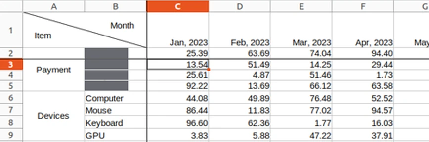
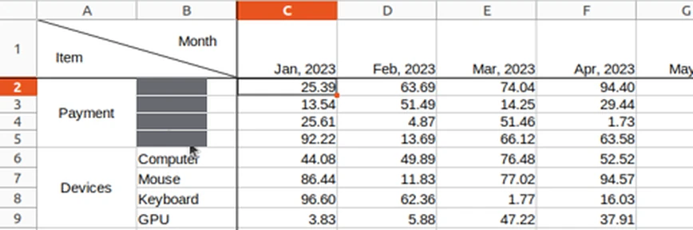
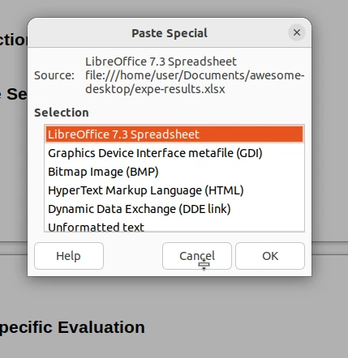
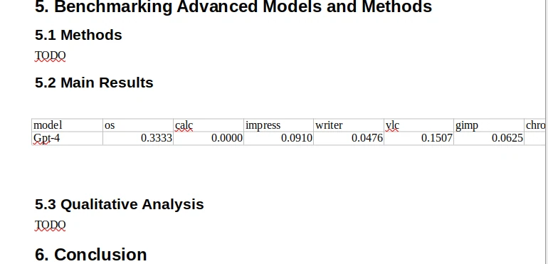

# 桌面轨迹案例 · 2026-11-28

7 组案例覆盖交接单中的 6 个问题。点案例名可以看每次试跑的评分、关键帧和逐帧说明。截图裁自原始桌面记录，红框是后加的标记，灰块遮住姓名。动作和画面按日志步号配对，界面有时会延后一帧才显示动作的结果。

| 案例 | 两次或多次试跑有什么区别 |
| --- | --- |
| [Calc 月均值，第 11 步分岔](fork-monthly-average/case.json) | 两次前 10 步都填到了三月。随后一次按 Tab 跳过四月，得 5/6；另一次输入四月公式，得 1。 |
| [VLC 音量，第 10 步分岔](fork-vlc-volume/case.json) | 前 9 步都在找设置。随后一次重复点原处，50 步后得 0；另一次点进 Qt 设置，在第 25 步结束，得 1。 |
| [Calc 冻结窗格并改名](calc-freeze/case.json) | 同一道题、两个批次。两次都改对了表名，一次多冻了第 2 行，得 0.5；另一次只冻首行和前两列，得 1。 |
| [按等级表填写三名学生的成绩](calc-three-grades/case.json) | 三格的正确值依次为 Pass、Excellent、Pass。四次终局按试次分别填对 2、0、1、3 格，各有一张红框截图。 |
| [从 Calc 把 GPT-4 的结果写入 Writer](writer-calc-gpt4/case.json) | 训练划分中的 OSWorld 原题。零分轨迹最早在第 5 步点到 VLC，之后回到了表格。第 50 步还停在选择性粘贴。另一次第 24 步已把表格粘进报告，最终得 1。 |
| [计数错十倍仍得满分](php-count-grader/case.json) | 把三个文本文件分别交给官方评分函数。正确答案 54 和错答 540 都得 1，错答 45 得 0。 |
| [未保存的表格和选区随虚拟机一起恢复](unsaved-snapshot/case.json) | 保存快照后同时改动 B2 和选区，再从快照恢复。保存快照前与恢复后的原始截图字节一致，应用内部读出的值、选区和未保存标志也一致。 |

## 先看两组图

下图左边的冻结线在第 2 行下方，右边在第 1 行下方。两次表名都正确，半分的差别就在这条线。

| 得 0.5 的试跑 | 得 1 的试跑 |
| --- | --- |
|  |  |

同一道跨应用题，左边用完 50 个动作时还在选择粘贴格式；右边已经能在报告中读到表头和 GPT-4 行。

| 50 步，得 0 | 34 步，得 1 |
| --- | --- |
|  |  |

## 如何引用

同一作业的分数按原试次顺序排列。冻窗格的两个批次分别列在 `scores_by_job`。跨应用原题保留两次独立 SFT 评估的来源。前两组分岔来自各自独立采样的筛题轨迹，未列入作业 23604025 的严核题单；它们展示发生过的动作差异，单靠这两次记录无法判定改一步会让成功率提高多少。

计数题的文件对照可以直接从 `controls/` 取用。快照组是一次 CPU 系统测试，三张图依次为保存前、改动后、恢复后。分布式桌面并发与筛题进度另见[筛题进度与桌面验收](../../docs/2026-11-28-筛题进度与桌面验收.md)。
