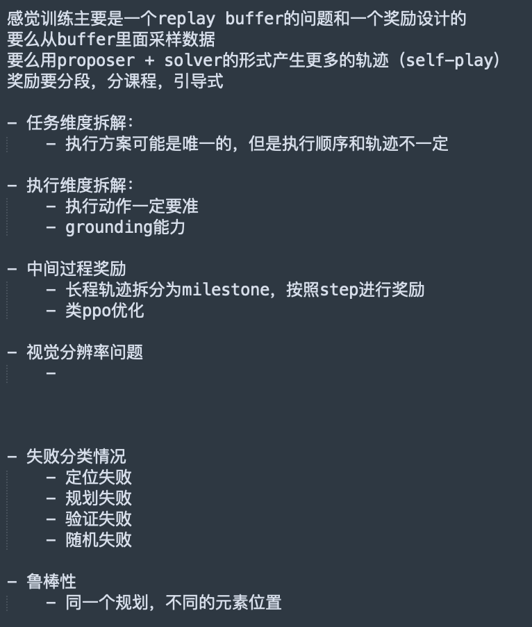

# GUI Agent 的轨迹、奖励与分支训练

讨论于 2026 年 11 月 26 日 18:39–19:32（北京时间），11 月 27 日归档。下文按对话顺序保留原图、提问、答复和后续修正。实验数字沿用讨论当天的记录。

## 讨论从这张图开始

## 一次桌面交互能用来学几次

> **提问 · 18:40**　只需要回答我的困惑就行，或者和我讨论

我同意你抓住了两个核心问题：**一次昂贵的桌面交互，能用来学几次？一条很长的轨迹，怎么知道哪一步值得学？** 前一个和 replay buffer 有关，后一个和奖励设计有关。对我们当前这批 OSWorld 题，我觉得第二个更值得先想清楚。

举个我们实际筛到的题：**根据等级表，给三名学生回填成绩。** 四次试做分别填对了三行、两行、零行和一行。这道题最有意思的地方是，学生可以按任意顺序处理，模型也可以复制粘贴、逐格输入，甚至用公式。只要检查“哪个学生的目标单元格里写对了什么”，就能识别进展，同时容许多种解法。这就是我理解的好 **milestone**：它描述一个可以核验的成果。点开表格、切换窗口、按下保存，本身很难说明完成了多少。[实际筛题记录](https://github.com/AVAW-sudo/CUA-RL/blob/3ea6c2a8655a770188c5f70c37cc4c2de7eb61ff/docs/CUA-RL%20Dataset%20OnePage.md?plain=1#L13)

这也引出我对你那句“从 buffer 采，或者 proposer + solver”的一个不同看法。**这两件事可以同时发生，而且它们解决的问题不同。** Proposer 负责出题，solver 负责尝试；buffer 决定哪些旧经验值得再次使用。对 GUI，我尤其想区分两种 replay：

- **回放旧轨迹**：模型重新学习上次成功时点了哪里、做了什么。它能复用稀少的成功经验，ARPO 已经在 OSWorld 上做过。[ARPO](https://arxiv.org/abs/2505.16282)
- **回到旧桌面，让当前模型重做**：比如恢复到“已经填对两行，即将填错第三行”的时刻，从那里再试几次。如果它看清了学生却点错行，值得查的是 **grounding**，也就是把意图落到正确的屏幕位置；如果它每次都给同一个学生查错等级，值得查的是它对任务和数据的理解。这样还能省下每次从头打开文件、找到表格的操作。

我更看好第二种，尤其是用它来理解失败。我们有 **62 道跨应用原题跑了至少 50 个动作却得零分**。这个数字告诉我们失败既多又贵，但只看终局，无法区分“第一步就读错了”和“前面都对，最后写错了一行”。同理，改变窗口位置、保持文件和任务相同，比单纯提高分辨率更能检验模型是否依赖固定坐标。[SFT 弱项统计](https://github.com/AVAW-sudo/CUA-RL/blob/3ea6c2a8655a770188c5f70c37cc4c2de7eb61ff/docs/CUA-RL%20Dataset%20OnePage.md?plain=1#L28)

所以我最想和你讨论的是：**我们要不要把“失败前还能挽回的桌面状态”也当成训练数据？** 这能把你图里的 replay、milestone、失败分类和鲁棒性串到同一个问题上。至于用 GRPO 还是 PPO，可以等我们看到模型从这些状态重试时究竟会发生什么，再做判断。

## 从已有轨迹可以确定什么

> **提问 · 18:41**　有哪些问题是可以确定的

目前能确定四件事。前两件是模型表现和评分器里已经观察到的问题，后两件决定了我们能从现有轨迹里学到什么。

1. **跨应用任务是这个 SFT 的明显弱项。** 在用于筛题的 77 道跨应用原题里，均分只有 **10.39%**，69 道得零分，其中 62 道记录了至少 50 个动作。这说明模型经常操作很久也没交出合格结果。至于是没看清目标、选错了文件、不会规划，还是最后写错位置，单凭这组数字分不出来。[SFT 审计](https://github.com/AVAW-sudo/CUA-RL/blob/3ea6c2a8655a770188c5f70c37cc4c2de7eb61ff/docs/CUA-RL%20Dataset%20OnePage.md?plain=1#L28)

2. **部分评分器确实会奖励错误结果。** 我们做过反例测试：一道姓名合并题只填对首行，余下 4,999 行全错，仍然满分。另有 4 道数字题，把正确答案扩大十倍，原评分器仍给满分。如果按这个分数挑“成功轨迹”放进 replay buffer，错误做法就会被当成正例。这是已经复现的问题。[评分反例](https://github.com/AVAW-sudo/CUA-RL/blob/3ea6c2a8655a770188c5f70c37cc4c2de7eb61ff/docs/CUA-RL%20Dataset%20OnePage.md?plain=1#L55) · [数字题复核](https://github.com/AVAW-sudo/CUA-RL/blob/3ea6c2a8655a770188c5f70c37cc4c2de7eb61ff/docs/CUA-RL%20Dataset%20OnePage.md?plain=1#L100)

3. **不少题的四次尝试给不出 GRPO 需要的组内差异。** 394 道有四次有效评分的候选题里，只有 **176 道**出现过不同的终局分数，另 **218 道四次同分**。用终局分做标准 GRPO 时，后面这 218 组里没有哪个尝试能被判为“比同组更好”。这不代表它们都太难，也不能据此断言加到八次仍然同分。[逐题评分](https://github.com/AVAW-sudo/CUA-RL/blob/3ea6c2a8655a770188c5f70c37cc4c2de7eb61ff/docs/CUA-RL%20Dataset%20OnePage.md?plain=1#L130)（共享工作区原始记录为 `runs/ais-dataset-screen/23533722/summary.json`）

4. **有些任务可以核验部分成果，但终局分数无法告诉我们哪一步出了错。** 三名学生回填成绩那道题，四次分别填对三行、两行、零行、一行。我们能验证“哪一行对了”，却不能只看最后的表格就断定“模型在第几步查错，还是后来覆盖了正确答案”。前者已经有证据，后者需要查看中间状态。[回填成绩实测](https://github.com/AVAW-sudo/CUA-RL/blob/3ea6c2a8655a770188c5f70c37cc4c2de7eb61ff/docs/CUA-RL%20Dataset%20OnePage.md?plain=1#L13)

所以，如果你问的是**现在最有把握解决哪个问题**，我的答案是：**先让训练信号能分清“做对、做了一部分、做错”**。至于 grounding 和规划谁是主要瓶颈、提高分辨率有没有用、回到失败前重试是否比回放成功轨迹更划算，这些仍是值得检验的假设。

## 图中的哪些判断成立

> **提问 · 18:44**　我是说图片里的

我刚才答偏了。你问的是，**图片里哪些判断本身成立，哪些还只是猜想**。按图里的六点来看：

| 图里的想法 | 能确定什么 |
|---|---|
| **Replay buffer / proposer + solver** | 两者可以同时用。Replay buffer 保存并复用已有经验；proposer 出题，solver 尝试解题。**“训练主要受限于 buffer 和奖励设计”还是假设**。另外，两个角色分工本身也不足以称为 self-play，要看它们是否根据彼此的表现持续调整。 |
| **任务维度拆解** | **同一个目标可以有多条正确轨迹，这点成立。** 比如回填三名学生的成绩，先填谁通常都行；如果后一步需要用到前一步查出的资料，两步就有先后依赖。所以拆任务时，可以规定“必须完成什么、哪些事有依赖”，同时容许不同操作顺序。 |
| **执行维度拆解** | **规划正确，执行仍然可能失败，这点成立。** 模型想点 B3 却点到 B4，是 grounding 或点击执行的问题；模型点准了 B4，但任务要求填 B3，则要查它为什么选错目标。两次屏幕上都表现为“填错格”，原因不同。 |
| **中间过程奖励** | **有可独立验证的阶段成果，就可以设计 milestone。** 但“每一步都该给奖”“越靠后越重要”“要用 PPO”都推不出来。阶段奖励回答的是**怎样衡量进展**，课程学习回答的是**先练哪些题**，PPO 或 GRPO 回答的是**怎样用这些反馈更新模型**。这三个决定可以分别做。 |
| **视觉分辨率** | **小字和密集控件可能在缩放后丢失辨认所需的信息**。能确定的是这种机制存在。至于它是不是我们的主要瓶颈，要看保持同一画面和任务、只改变模型看到的清晰度后，它能否更稳定地读对或点对。 |
| **失败分类与鲁棒性** | 定位、规划、验证都可以作为排查方向，但这些类别可能重叠。尤其“随机失败”应先记为**原因未明**，同题两次结果不同还不足以归因。图里“同一个规划，不同的元素位置”则是一个清楚的鲁棒性测试：保持任务和内容相同，只移动窗口或控件，看模型还能否完成。 |

我觉得图里**最扎实、也最值得作为研究起点**的是这句：**同一个任务可以有多条正确轨迹，但其中一些中间成果可以被客观验证。** 从这里往下推，就有了选择阶段奖励的依据。至于 buffer、self-play、分辨率和 PPO 谁最重要，这张图提出了几个好问题，目前还排不出优先级。

## SCALE-CUA 怎样训练桌面操作

> **提问 · 18:47**　当前scale-cua是如何做的呢，关于这几个问题？

**SCALE-CUA 会拆任务，也会把长轨迹切成段，但这两件事发生在不同环节。** 拆任务是为了生成新的训练题。切轨迹是为了控制截图占用的上下文。正式 RL 时，同一道题让当前模型独立尝试 8 次，按每次尝试的最终结果算 GRPO；同一条轨迹里的各段共享这次尝试的训练信号。[论文 §3 与附录 D](https://arxiv.org/html/2607.11185#A4)

对应你图里的六个问题，可以这样理解。

| 你关心的问题 | SCALE-CUA 实际怎样做 |
|---|---|
| **1. Replay buffer，还是 proposer + solver？** | 两种思路都涉及。**造题时**，VeriGen 有三个角色：proposer 写题和评分器，judger 审查题意与判分逻辑，checker 在真实桌面试做。旧轨迹也会被拿来生成新题。**训练时**，标准配置用 Frontier Sampling 选题，再由当前模型重新做。它优先抽近期成功率接近 **50%** 的题，保留 **20%** 随机探索。代码另有成功轨迹 replay 模式，我们当前的八卡配置启用的是 Frontier。公开流程里也没有让出题者和解题者在每轮 RL 中相互训练。[VeriGen](https://arxiv.org/html/2607.11185#S3.SS2) · [官方采样代码](https://github.com/THUDM/SCALE-CUA/blob/3929e2fe364623153f2caa94ead71dc1aea50fb0/scalecua_rl/examples/training/async_trainer.py#L500) · [我们的配置](https://github.com/AVAW-sudo/CUA-RL/blob/3ea6c2a8655a770188c5f70c37cc4c2de7eb61ff/configs/qwen3vl-osworld-original-pilot-8gpu.yaml#L25) |
| **2. 任务如何拆？执行顺序是否固定？** | **失败时拆，成功时合。** 对失败轨迹，VeriGen 查看动作和环境反馈，尝试找到最早偏离目标的位置，把中间目标做成更简单的独立题，每题有自己的初始状态和评分器。对成功轨迹，它会把同应用里相关的目标合成更难的题。模型在桌面上自行选动作；如果评分器检查的是最终文件，两条不同路径都可能得满分。[论文 §3.2](https://arxiv.org/html/2607.11185#S3.SS2) |
| **3. Grounding 和执行准确性怎么练？** | 模型每轮看截图，直接输出点击、拖拽、键盘输入等动作。点击位置用 **1000×1000 的相对坐标**表达，执行器再换算成实际像素。RL 阶段冻结视觉编码器，只更新语言模型部分。主训练信号来自任务结果，没有给每次点击单独标注“应该点哪个元素”。所以点错位置和点准了错误目标，都可能得到同一个零分。[动作接口](https://arxiv.org/html/2607.11185#A1.SS1) · [训练细节](https://arxiv.org/html/2607.11185#A4) |
| **4. 有没有 milestone、过程奖励和课程学习？** | **有按能力选题的课程，有独立子任务，标准 RL 主要用终局奖励。** 同题 8 次尝试互相比较，得到每次尝试相对同组好多少或差多少，这个量叫 *advantage*。一条轨迹的各段共享它。评分器可以给部分分，未在步数限制内完成也有惩罚，但模型不会因“刚完成第二个子目标”就在那一步自动拿到独立奖励。优化器用 GRPO，没有另外训练给每一步估值的 PPO critic。[论文 §3.3](https://arxiv.org/html/2607.11185#S3.SS3) · [附录 D 的训练目标](https://arxiv.org/html/2607.11185#A4) |
| **5. 视觉分辨率怎么处理？** | 要区分三个数字。**1000×1000** 是动作坐标系；论文 OSWorld 动作接口描述的桌面是 **1280×800**；我们八卡 RL 配置请求的图像是 **1280×720**。论文专门研究的是**保留多少张历史截图**：保留文字历史，分批移除旧图。在一项“把多个浏览器标签页按标题存成 PDF”的案例中，9B 模型窗口设为 5 张时成功 **7/8**，设为 1 张时 **0/8**。这个实验说明历史画面会影响执行，无法据此判断提高像素分辨率能带来多少收益。[论文 §4.5](https://arxiv.org/html/2607.11185#S4.SS5) · [八卡图像配置](https://github.com/AVAW-sudo/CUA-RL/blob/3ea6c2a8655a770188c5f70c37cc4c2de7eb61ff/configs/qwen3vl-osworld-original-pilot-8gpu.yaml#L109) |
| **6. 怎么分类失败、测布局鲁棒性？** | 造题时会尝试定位最早偏离目标的动作，也会审计评分器。作者人工复核了 **100 条 OSWorld 样本**，程序评分和人工判断的一致率是 **78%**。但在我核对的主训练流程里，没有把每条失败系统地归为“定位、规划、验证、随机”再分别训练。我也没看到“固定任务和内容，只移动元素位置”的成对评测；它报告的跨任务表现无法单独回答这个问题。[VeriGen 失败轨迹处理](https://arxiv.org/html/2607.11185#S3.SS2) · [人工审计](https://arxiv.org/html/2607.11185#A2.SS3) |

拿你关心的**跨表回填**举例，区别最清楚。假设模型查对了三名学生的成绩，却写错了目标行。SCALE-CUA 已经会利用这段失败经历，生成一道更简单的“查出成绩”或“找到目标行”的题，供模型下次单练。**它留下的问题是：在这一次原始长任务里，能否当场确认“查值已经做对”，再把“写错行”的反馈落到后面的操作上？** 这才是你图里的阶段奖励与 SCALE-CUA 基线最实质的差别。

## VeriGen 怎样从失败轨迹出题

> **提问 · 18:52**　**失败时拆，成功时合。** 对失败轨迹，VeriGen 查看动作和环境反馈，尝试找到最早偏离目标的位置，把中间目标做成更简单的独立题，这个是怎么做的呢

我前面说“找到最早偏离目标的位置”，说得太确定了。**VeriGen 先用关键词猜一个可能出错的位置，再让出题模型参考这段轨迹，写一道可以独立完成、独立判分的小题。** 看一个实际发布的例子，最容易理解。

**1. 先看原题是怎么失败的。** 原题要求查出 2019–2022 年 ACL 最佳长论文奖，把论文标题、年份、作者和 PDF 链接填进桌面上的 Excel，再按年份倒序排列。模型在 ACL 网站和 Google 上查了 50 轮，只填入部分数据，最后用完步数。[实际轨迹摘要和生成的新题](https://huggingface.co/datasets/extreme1228/ScaleCUA/blob/ca4266e614883a8bed5b8e9caf4f0fcbccb6a023/osworld/rl_tasks/multi_apps/67890eb6-6ce5-4c00-9e3d-fb4972699b06_traj_verify_4.json)

**2. 再猜模型从哪里开始遇到困难。** 公开代码从第 4 个动作开始，按顺序扫描模型当时写下的判断和动作摘要，找 `wrong`、`failed`、`doesn't`、`try a different approach` 等关键词。第一次命中就标记该步。如果一直没命中，就取轨迹中点。这条轨迹标记的是索引 `16`，也就是第 17 个动作。当时模型说，页面里看到的还是普通论文，好像没有获奖信息，随后继续向下滚动。这说明**模型在这一步意识到了问题**。它究竟是更早就选错了页面，还是在正确页面上继续查找，关键词规则无法判断。[失败位置的判定代码](https://github.com/THUDM/SCALE-CUA/blob/3929e2fe364623153f2caa94ead71dc1aea50fb0/VeriGen/src/generation/trajectory_guidance.py#L408)

**3. 出题模型据此写一道范围更小的新题。** 它可以参考原题、之前的操作和选取的截图，挑一个目标，为它写新指令和自动评分程序。新题沿用原题的桌面和文件配置，从初始状态重新做。这个例子实际生成的一题是 **“把 `best_awards_acl.xlsx` 的第一行表头全部居中”**。模型完成操作后，评分程序读取保存的表格，检查表头是否居中。整条失败轨迹在这里用来生成训练数据，没有给旧轨迹的第 17 步直接分配奖励。[出题规则](https://github.com/THUDM/SCALE-CUA/blob/3929e2fe364623153f2caa94ead71dc1aea50fb0/VeriGen/src/generation/trajectory_guidance.py#L79) · [新题的环境配置](https://github.com/THUDM/SCALE-CUA/blob/3929e2fe364623153f2caa94ead71dc1aea50fb0/VeriGen/src/generation/runtime_templates.py#L279)

这个例子也说明了“拆题”的局限。**查不到获奖论文，和不会把表头居中，是两种不同的困难。** 表头居中甚至不是原题要求的步骤。VeriGen 确实从一次失败中造出了一道便宜、可评分的 Excel 题，但做对这道题，不能说明模型更会查获奖论文了。

所以回到我们筛 256 题的目标，我会追问一句：**模型把这道小题练好了，重做原题时，具体哪一步会更容易？** 在这个例子里，“从 ACL 2022 的会议页面找到最佳长论文，并提交官方 PDF 链接”就和观察到的困难联系得更直接。

## ACL 获奖论文的两道小题

> **提问 · 18:57**　对于你这个例子，会怎么生成小题呢？

拿前面那条“找了 50 轮，没填完 ACL 获奖论文表格”的轨迹来说，**VeriGen 实际生成了两道小题**：

| 给模型的新指令 | 程序怎么判分 |
|---|---|
| 打开桌面上的 `best_awards_acl.xlsx`，冻结首行，让表头在向下滚动时保持可见。 | 读取保存的文件，检查冻结位置是否为 `A2`。 |
| 打开同一个文件，把第一行的四个表头全部居中。 | 读取 `A1:D1`，检查表头的水平对齐方式是否为居中。 |

为什么会生成这两题？出题规则允许模型从失败轨迹中挑一种已经接触过的操作，再围绕它写一道容易验证的题。原题用到了 Excel，于是出题模型保留了那份表格，去掉了查论文、跨年份整理等要求，另外设计了两个表格操作。**冻结首行和表头居中都是新加的要求。** [出题规则](https://github.com/THUDM/SCALE-CUA/blob/3929e2fe364623153f2caa94ead71dc1aea50fb0/VeriGen/src/generation/trajectory_guidance.py#L79) · [冻结首行的原始样本](https://huggingface.co/datasets/extreme1228/ScaleCUA/blob/ca4266e614883a8bed5b8e9caf4f0fcbccb6a023/osworld/rl_tasks/multi_apps/67890eb6-6ce5-4c00-9e3d-fb4972699b06_traj_verify_3.json) · [表头居中的原始样本](https://huggingface.co/datasets/extreme1228/ScaleCUA/blob/ca4266e614883a8bed5b8e9caf4f0fcbccb6a023/osworld/rl_tasks/multi_apps/67890eb6-6ce5-4c00-9e3d-fb4972699b06_traj_verify_4.json)

**如果由我针对这次失败出题，我会保留“找到获奖论文”这个目标，做两道只差起点的题。** 两题都只查 2022 年，都只要一个论文标题，都把答案填进同一个单元格。

| 我会生成的小题 | 初始桌面 | 给模型的指令 |
|---|---|---|
| A | 浏览器已打开 ACL 2022 官方获奖名单 | 在当前页面找到一篇获得最佳长论文奖的论文，把标题填入表格 `A2`。 |
| B | 浏览器已打开 ACL 2022 会议首页 | 从会议首页找到当年的获奖名单，查出一篇获得最佳长论文奖的论文，把标题填入表格 `A2`。 |

两题共用一个判分程序：事先从官方获奖名单核实可接受的标题，最后读取 `A2` 比对。**B 比 A 只多了一件事：自己找到获奖名单。** 如果模型多次能做对 A，却经常做错 B，我们就有理由优先练网页导航和信息查找。如果连 A 也经常错，就看它是认错了奖项、抄错了标题，还是没把内容写进表格。

这也是我对我们这 256 题的建议：**优先保留那些能回答“模型究竟卡在哪一步”的小题。** 这对围绕 SFT 弱点筛数据，比单纯挑出同一软件里更容易的操作更有价值。

## 任务分工与桌面状态分支

> **提问 · 18:59**　如果把task作为一个tree，我认为现在cua agent都是在dft地进行操作，似乎没有bfs这种多个subagent地来操作？

**SCALE-CUA 确实是单条轨迹串行操作，但已经有 CUA 在 OSWorld 上让多个 subagent 并行做同一道题。** 这里最值得区分的是，你画的树里，每个节点代表的是**一项子任务**，还是**操作之后的桌面状态**。这两种树，用途很不一样。

先说 SCALE-CUA。它在一次 `rollout`（模型从初始桌面尝试完成任务的全过程）里，看截图、选动作、再看下一张截图。你说的 DFT，我理解是 DFS（深度优先搜索）。“沿一条路往下走”这个直觉是对的，但严格的 DFS 还会记住没试过的岔路，之后回去继续探索。SCALE-CUA 的官方 RL 配置是**同一道题从头采样 8 条轨迹**，每条各走各的。VeriGen 则在事后看轨迹、生成新题。这两处都没有在做到一半时派出 subagent。[SCALE-CUA 论文，§3.2 与附录 D](https://arxiv.org/html/2607.11185)

**第一种并行是分工。** 拿 ACL 那题来说，让四个 subagent 分别查 2019、2020、2021、2022 年的获奖论文。每个交回标题、作者和官方链接，最后由一个 agent 统一写 Excel。**四份结果都要保留。** 这正是 *Multi-Agent Computer Use*（MACU）研究的做法。它让 manager 把任务画成依赖图，凡是前置条件已经满足的子任务就可以同时派出去。某一年查完了，也可以先核对那一年的链接，不必等另外三年。你说的“多个 subagent 横着展开”，如果指这种，MACU 就是直接对应的工作，而且测了 OSWorld。[MACU 论文](https://arxiv.org/abs/2606.01533)

**第二种并行是试路。** 还是同一题，这次只查 2022 年。模型到了那个“只看到普通论文”的页面，可以让一条分支继续翻当前页面，另一条返回会议官网找 Awards，第三条尝试站内搜索。**只要一条路找到可核实的名单，就足以继续。** 这更接近你说的搜索树。BFS（广度优先搜索）指逐层展开候选节点，单个 agent 也能做；多个 agent 则可以让几条路同时试。桌面上已有很接近的工作 **ENVS**。它在同一状态采样多个下一步动作，动作确实有分歧时才开分支，让子虚拟机重放此前的操作，再走不同的路。它用这些分支收集训练轨迹，由 OSWorld 验证哪些轨迹最终成功。[ENVS 论文，§3.1–3.3](https://arxiv.org/html/2606.22948v1#S3)

**放回我们的 RL 问题，我觉得第二种尤其值得讨论。** 那条失败轨迹里，模型已经花了不少步才走到“页面里都是普通论文”这个位置。如果训练预算还能买 4 次尝试，是让模型**从桌面起点重做 4 遍**，还是让它**从这个岔路口试 4 种后续做法**？后者能让我们直接比较，在相同历史下，“继续滚动”和“换入口”各自有多大机会完成任务。真正要验证的是，在**相同的桌面交互步数**下，这样分配探索预算，能不能让训练后的模型**独自做一次时**也更容易选对路。

## TA-GRPO 与 Turn-PPO 各自解决什么

> **提问 · 19:15**　那么你为什么觉得TA-GRPO和turn-PPO可以试一试？SCALE-CUA是什么做法？

我觉得 TA-GRPO 和 Turn-PPO 值得试，是因为 **SCALE-CUA 用整次尝试的结果，来更新这次尝试里的每一步**。对几十步的桌面任务，这个信号有时太粗。两种方法针对的是同一个问题，但依赖的条件不同。

沿用 ACL 的例子。假设模型第 8 步找到了正确的获奖名单，第 20 步把论文填进表格，最后关闭文件时点了“放弃保存”，最终得 0 分。我们希望它下次保留前面的查找策略，改掉最后的操作。三种方法会怎么处理？

### SCALE-CUA：比较同一道题的整条轨迹

官方训练对同一道题独立尝试 8 次，根据每次的最终得分，计算它比同组平均表现好多少。这个相对值叫 **advantage（优势）**，训练用它决定哪些输出应该变得更常见。**同一条轨迹的所有片段共享同一个优势。** 如果另外几次成功了，这条失败轨迹拿到负优势，第 8 步找到名单和最后放弃保存都会用这个负值更新。如果 8 次最终得分完全相同，这一组的相对优势就是零。[SCALE-CUA 论文，附录 D](https://arxiv.org/html/2607.11185#A4)

这里有两个容易混淆的地方。SCALE-CUA 的 **Frontier Sampling** 会优先抽模型有时做对、有时做错的题，增加同组出现分差的机会。它的**视觉上下文分段**则是为控制截图占用、提高训练效率。两者都保留了“整条轨迹共享优势”的做法。前面讨论的 VeriGen 拆题发生在生成训练题时。[SCALE-CUA 方法与训练目标](https://arxiv.org/html/2607.11185)

### TA-GRPO：有些中间结果，桌面环境自己就能核验

Gamer 的做法是用记忆摘要把长轨迹连成几段，把**同一道题、到达同一段号**的尝试放在一起比较。如果这一段的目标可以核验，就用核验结果算段级优势，再让靠近段末的动作获得更大的权重。整个过程不用额外训练价值模型。[Gamer 论文 §4](https://arxiv.org/html/2611.18397v1#S4)

这在 ACL 题上有一个具体用途。假如我们能在中途可靠检查“浏览器是否已经打开正确的获奖名单”，那么即使后来表格没保存，**找到名单这一段仍然可以得到正向信号**。但迁移到桌面的难点也在这里：第 2 段里，有的尝试已经开始填表，有的还在找网页；同一段号并不保证进度相同。段末也可能只是滚了一下鼠标，真正关键的是更早选对了网站。

所以我对 TA-GRPO 的判断有个前提：**优先在有可靠中间产物的题上试。** 如果手里只有最终分数，只做“越靠后权重越大”，那可以作为一个低成本对照，但它单独验证的是时间加权，不能代表完整的 TA-GRPO。

### Turn-PPO：只有终局分数时，也可以尝试学习哪些状态更有希望

Turn-PPO 多训练一个 **critic（价值模型）**。迁移到桌面时，可以让它在每轮操作前读任务、截图和已有历史，估计“从这里继续按当前策略做，预计最后能拿多少分”。算法结合操作前后的价值估计和后续实际奖励，为这一轮计算优势。这一轮输出里的词元共享这个优势，下一轮可以得到不同的值。[Turn-PPO 原论文](https://aclanthology.org/2026.findings-eacl.328/)

还是同一个例子。如果 critic 从其他尝试中学到“打开正确获奖名单后，最终做对的机会明显上升”，它就**有机会**给第 8 步和最后放弃保存分配不同的信号，不必为每道题手写“找到了名单”的检查器。代价是多训练一个能看懂桌面的模型。它也可能把“打开了一个看起来很像的页面”误判为进展。Turn-PPO 原论文验证的是 WebShop 和 Sokoban，迁移到 OSWorld 的收益还要实测。[Turn-PPO 实验](https://aclanthology.org/2026.findings-eacl.328/)

**结合我们的 8 张 A100，我的优先级是：先跑稳原版 SCALE-CUA，再在可核验中间产物的题上试 TA-GRPO，最后试只用原终局评分的 Turn-PPO。** 我们自己的筛选里，有 253 道题各有至少两条超过 20 次模型调用的轨迹，其中 110 道的最终得分有差异。这说明我们手上确实有“走了很久，结局却不同”的样本，适合检验更细的训练信号究竟有没有用。比较时最有说服力的指标，是在相同桌面交互预算下，训练后的模型单独做一次，能否更常做对。[项目筛选统计与实验约定](https://github.com/AVAW-sudo/CUA-RL/blob/3ea6c2a8655a770188c5f70c37cc4c2de7eb61ff/docs/CUA-RL%20Dataset%20OnePage.md?plain=1#L130)

接回你刚才的树：**分支搜索决定在哪个岔路口多试几条路；TA-GRPO 和 Turn-PPO 决定走完这些路后，怎样从沿途的动作里学习。** 这是两个可以分开验证的问题。

## Turn-PPO 怎样利用一棵搜索树

> **提问 · 19:20**　我怎么感觉Turn-PPO这种很适合tree的这种训练？

是的。**如果你说的树，是“从同一个桌面状态尝试不同动作”，Turn-PPO 和它很搭。** Turn-PPO 本来就要估计：模型走到这一轮，按当前策略继续做，预计最终能拿多少分？从这个位置多走几次，恰好能给这个估计提供证据。原版 Turn-PPO 用普通轨迹就可以训练，分支是可以加上去的采样方式。[Turn-PPO 原论文](https://aclanthology.org/2026.findings-eacl.328/)

拿 ACL 那题来说。模型已经走了 16 步，屏幕上仍然是普通论文列表。现在保存**同一份桌面状态和模型历史**，从这里继续采样。假设得到下面的结果，数字只是举例：

| 在第 17 步做什么 | 之后交给同一个策略继续操作 | 最终完成原题 |
|---|---|---|
| 留在论文列表，继续往下翻 | 4 次 | 0 次 |
| 返回会议首页，去找 Awards 入口 | 4 次 | 3 次 |

如果只有原来那条失败轨迹，我们只知道“这次翻下去，最后没做成”。现在多知道了一件事：**前 16 步完全相同，换一个第 17 步，后面几次尝试的结果就有了差异。** 四次仍然很少，不能认定滚动必错，但已经值得模型更新对这个决策的判断。

这里有个细节，也是我觉得这个思路有意思的地方。**Turn-PPO 的 critic（价值模型）在点鼠标之前，只能给当前状态一个估值。** 点完之后，两条路出现了不同的页面，critic 才可以分别估计“停留在论文列表”和“已到达获奖入口”各有多大希望。训练时，分支的真实终局结果可以校准这些估计。等遇到另一场会议、另一个网站，即使预算只够走一条路，我们仍希望 critic 能认出相似的进展。这就是多训练一个 critic 可能带来的收益。

不过，树本身也提供了一个很强的对照：**既然同一地点已经试过几条路，直接用这些分支的最终得分来训练，也能学到东西。** Tree-GRPO 就利用了这种比较。与你的直觉更接近的是 FOCUS，它专门挑选值得多试几次的中间状态，用后续结果改善 critic，再用 critic 给沿途决策分配训练信号。它验证了法律推理、深度搜索和代码定位上的效果，OSWorld 桌面仍是需要实测的场景。[Tree-GRPO](https://arxiv.org/abs/2509.21240) · [FOCUS](https://arxiv.org/abs/2610.35801)

所以，如果我们把研究问题定成**“怎样从 GUI 操作的岔路口学得更好”**，我会把 **Turn-PPO 的优先级提到 TA-GRPO 前面**。Gamer 的 TA-GRPO 比较同一任务、同一段号的不同尝试，两条轨迹到这一段时可能已经处在完全不同的页面。你的设想则刻意固定分岔前的状态，正好能研究“在这里换个动作会怎样”。[Gamer §4.1](https://arxiv.org/html/2611.18397v1#S4.SS1)

对我们最有区分力的实验，是让**直接比较分支得分**和 **Turn-PPO 加 critic** 使用同一批分支，再用**普通 Turn-PPO**检验分支采样本身的价值。三者对齐总桌面操作数，计入恢复桌面的耗时，最后看模型在新题上**只做一次**的成功率。这样才能回答：提升究竟来自训练时多试了几条路，还是模型真的学会了在没试过的岔路口做判断。

## FOCUS 和 Turn-PPO 的关系

> **提问 · 19:28**　focus本身是一个turn-PPO-based 方法吗

严格说，**FOCUS 是 PPO-based，但不能把它归为 Turn-PPO 的直接扩展**。我前面引用它，是因为它验证了你直觉中的一部分：**从同一个中间状态多试几条路，可以帮助 critic（价值模型）更准确地估计，从这里继续做，最终能拿多少分。** [FOCUS 论文 §2](https://arxiv.org/html/2610.35801v2#S2)

两种方法有一个明确的技术区别：

- **Turn-PPO 按一轮交互更新。** 模型给出一次完整回复，环境返回一次反馈，这算一轮。算法为这一轮估计一个优势值，并以整轮回复为单位限制策略更新幅度。[Turn-PPO 原论文，第 5 页](https://aclanthology.org/2026.findings-eacl.328.pdf#page=5)
- **FOCUS 的主要实验按一段交互分配优势。** 一段可以包含多轮。它选择一些中间状态，从那里额外采样几条后续轨迹，用实际结果修正价值估计。相邻两个状态之间的整段操作共享一个优势值，策略更新时则逐个 token 做 PPO 裁剪。[FOCUS §2.2，公式 3–5](https://arxiv.org/html/2610.35801v2#S2.SS2)

所以，你设想的 **“在 GUI 决策点分叉，用分支结果训练 critic，再按每一轮操作做 Turn-PPO 更新”**，可以准确地说成：**把 FOCUS 的选择性分支思路用到 Turn-PPO 上。** 这是我们讨论的组合方案，和 FOCUS 论文实际验证的算法有区别。

## 把选择性分支搬到 CUA

> **提问 · 19:31**　搬到CUA的场景中呢？

可以搬到 CUA。**我觉得最值得搬的是 FOCUS 的一个想法：挑少数难判断的桌面状态，多试几次，用真实结果教 critic 判断“从这里继续，预计能得多少分”。** 再把这个 critic 接到 Turn-PPO，按每一轮 GUI 操作分配训练信号。这个组合是我们可以检验的方案。FOCUS 原论文主要在上下文压缩处分段，按段计算优势。[FOCUS 方法](https://arxiv.org/html/2610.35801v2#S2) · [Turn-PPO 方法](https://aclanthology.org/2026.findings-eacl.328/)

**拿我们筛过的 Calc 题举例。** 题目要求冻结首行和前两列，再修改工作表名称。我们用实际文件测过评分器，只冻结首行、只冻结两列或改错表名的关键错例，都只得 0.5 分。这道题适合做第一轮实验，因为最后交上来的文件可以直接判分。[项目里的评分器验证记录](https://github.com/AVAW-sudo/CUA-RL/blob/3ea6c2a8655a770188c5f70c37cc4c2de7eb61ff/docs/CUA-RL%20Dataset%20OnePage.md?plain=1#L124)

假设模型已经改好了表名，现在打开“视图”菜单，准备冻结窗格。训练可以这样做：

1. **保留这个决策点。** 保存虚拟机状态，以及模型当时看到的截图、操作历史和剩余步数。当前选中了哪个单元格，会直接影响冻结结果。只保存一张菜单截图，恢复不了这道题。
2. **让同一策略从这里继续几次。** 一次可能直接点“冻结首行”，另一次可能先回到表格选中 C2，再冻结行列。每次都让模型自己做到结束，用原评分器检查最终文件。假如某条路线反复得到 1 分，另一条常得 0.5 分，这就提供了比单次成败更有用的比较。具体分布要靠实跑。
3. **把这些结果用在两个地方。** 对分岔前的 critic，多次续跑帮助它估计“到了这个菜单，当前策略通常能拿几分”。对后续每一轮，Turn-PPO 则可以利用动作前后的价值估计和最终得分来更新策略。**调出菜单、选中 C2、点冻结、保存文件，这几步可以有不同的训练信号。** 最终希望模型学会自己选对，评测时一次走完。

**CUA 真正难的是决定在哪里花这几次额外尝试。** 比如模型正在错误的工作表上一遍遍点菜单，剩下两步，几乎没有机会补救，再跑几次可能只得到同样的低分。更有价值的是这种位置：前面的操作都合理，模型还有足够步数，但接下来选哪个命令会改变最终产物。按 FOCUS 的思路，选点看的是“再采一次，预计能让价值估计准多少”。桌面上已有 ENVS 从中间状态分支的先例，它用成功分支做监督训练。我们这里想验证的是，成功、部分成功和失败的分支，能否共同训练出更准的 critic。[FOCUS 选点方法](https://arxiv.org/html/2610.35801v2#S2.SS3) · [ENVS 的 OSWorld 实验](https://arxiv.org/abs/2606.22948)

**对我们这套 8×A100，我会先选本地 Calc、Writer 任务做对照。** 仓库已有恢复干净桌面的 QEMU 快照代码，还需要实测能否从**任务中途**准确恢复选区、未保存文件和模型历史，以及恢复一次要多久。实验比较三组就能回答核心问题：普通 Turn-PPO、随机选位置分支的 Turn-PPO、选择性分支的 Turn-PPO。三组对齐真实桌面操作数，另记恢复耗时，最后看未参与训练的题上**单次完成率**。其中最重要的是后两组的差距，它能告诉我们，哪些桌面决策真的值得多试一次。[现有快照实现](https://github.com/AVAW-sudo/CUA-RL/blob/3ea6c2a8655a770188c5f70c37cc4c2de7eb61ff/scripts/snapshot_vm.py#L56)
